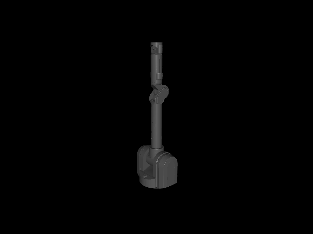
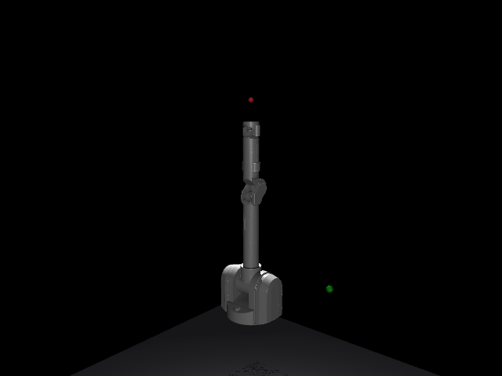
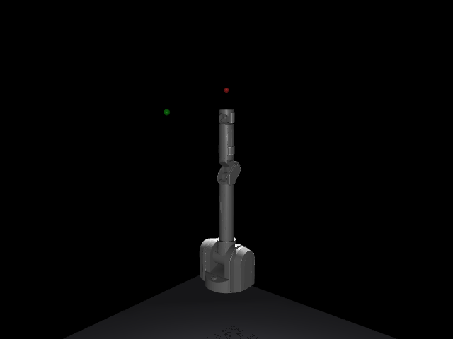
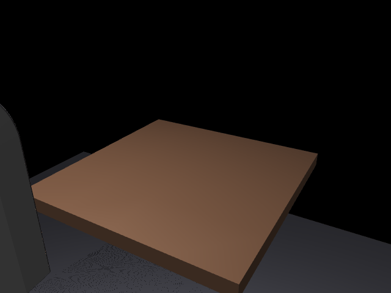

# Barrett WAM Manipulation

A manipulation project for the Barrett WAM (Whole Arm Manipulator): a 7-DOF arm plus the
BarrettHand, simulated in MuJoCo. A separate project (and repo) from `go1_rl_walk`, `slam_sim`,
and `wam` (sibling directories), following the same convention: each new kind of problem gets
its own repo, not a branch of an existing one.

<p align="center">
  
</p>

*Stage 1's verification sweep: each of the 7 arm joints swept through its own range in turn,
then the three BHand fingers closing and opening together.*

**Note on the name**: this project is named after the actual Barrett WAM arm (the robot this
repo simulates), which is unrelated to the sibling `wam` repo's "World Action Model" (a learned
dynamics model for the Unitree Go2 quadruped) -- a naming collision flagged and resolved before
starting this project. They share no code.

## Scoping decisions

- **Platform: the real Barrett WAM 7-DOF arm + BarrettHand**, not a more commonly-available
  research arm (Franka Panda, UR5e) or a simpler 6-DOF industrial arm -- chosen for the more
  dexterous 3-finger underactuated hand and because no ready-made MuJoCo model existed for it in
  this environment (`mujoco_menagerie`, vendored locally at `~/robo/mujoco_menagerie`, has Franka/
  UR5/Kinova/Shadow Hand/Allegro Hand models but no Barrett WAM), making this a genuine build
  rather than importing an already-solved asset.
- **First task: reach a target**, not grasping or pick-and-place -- the simplest closed-loop
  control problem (drive the end-effector to a commanded pose, no contact/grasp physics to get
  right yet), matching this project's own established staged-build discipline (verify the
  simplest real capability before adding the next one).
- **Simulator: MuJoCo**, reusing the same physics engine every sibling project already uses, via
  `go1_rl_walk/mpc`'s venv (same `mujoco>=3.1.0` dependency, no new venv needed).

## Staged plan

1. **Simulator core: vendor and fix a real Barrett WAM + BHand MuJoCo model -- DONE.**
   No MuJoCo-ready model existed for this robot anywhere in this environment, so this stage is
   genuinely about getting one to load and move correctly, not just importing a solved asset.

   Source: [`jhu-lcsr/barrett_model`](https://github.com/jhu-lcsr/barrett_model) (the standard
   ROS description package for this robot), specifically `robots/wam7_bhand.urdf.xacro` (7-DOF
   arm + BHand). Three real problems hit and fixed along the way, not glossed over:
   - **Xacro `$(find barrett_model)` package references don't resolve outside a real ROS
     package.** Worked around by substituting the literal clone path via `sed` before running
     `xacro` (ROS 2 Jazzy's `xacro` CLI, already installed in this environment) to expand the
     macros into a plain, static URDF.
   - **MuJoCo's URDF importer can't parse `.dae` collision meshes** (`no decoder found for mesh
     file ...`) -- every `<collision>` mesh reference used Collada (`.dae`) convex-decomposition
     files. Fixed by substituting each one with its link's own `_fine.stl` visual mesh (already
     present on disk for every link) as the collision geometry too -- a deliberate simplification
     (losing the original convex-decomposition's collision precision) accepted for this stage,
     since the goal here is "loads and moves correctly," not production-grade contact dynamics;
     revisit if a later grasping stage needs tighter finger-pad collision geometry.
   - **One link's inertia tensor is degenerate** (`wam/wrist_yaw_link`, `ixz` in the upstream
     URDF is suspiciously identical to `iyy` -- almost certainly a copy-paste error in the
     original file, not a modeling choice) -- MuJoCo's compiler correctly rejects it
     (`inertia must have positive eigenvalues`). Found by computing eigenvalues of each link's
     3x3 inertia matrix directly (one negative eigenvalue on this link, all 22 others fine) and
     fixed by zeroing that link's off-diagonal terms, keeping its diagonal (clearly sane) values.
   - Vendored only what's actually used: the final URDF (`assets/wam7_bhand.urdf`) plus the 13
     `_fine.stl` meshes it references (5.7MB total, `assets/meshes/`) -- not the full 133MB
     upstream repo (which also carries `.blend` source files and unused collision-decomposition
     variants).

   **Verified, not just "it didn't crash"**: loads with 15 joints (7 arm + 8 BHand, matching the
   real BHand's underactuated kinematics -- fingers 1/2 each get a spread+flex+distal joint,
   finger 3 has no spread since it's fixed relative to the palm on the real hardware), joint
   limits match published WAM/BHand specs (e.g. elbow 0-180°, wrist pitch ±90°). Visually
   confirmed via the demo GIF above and a direct elbow 0°-vs-180° comparison render -- the
   forearm genuinely folds back alongside the upper arm, not just a qpos number changing with no
   visible effect.

2. **Reach a target -- DONE.** Turns out the "fixed-base mount" item flagged as needed above
   was already a non-issue: the URDF's root joint (`wam/wam_fixed_joint`) is `type="fixed"`,
   not floating, so MuJoCo's URDF importer welds `wam/base_link` straight to the world with no
   free joint at all (confirmed: `nq == nv == 15`, matching exactly the 15 revolute joints,
   no extra 6/7 DOF from a floating base). The actual new work:

   - **Compiled the URDF to a static MJCF** (`assets/wam7_bhand.xml`, via
     `mj.mj_saveLastXML`) so actuators, sites, and a target-marker mocap body could be added
     -- MuJoCo's URDF importer has no mechanism for any of those, and doesn't auto-generate
     actuators from URDF `<transmission>` tags (`model.nu == 0` on a raw URDF import). The
     original `assets/wam7_bhand.urdf` stays as Stage 1's artifact; `wam7_bhand.xml` is now
     the model every script after Stage 1 loads.
   - **Two actuators per arm joint** (7 arm joints only -- the BHand stays passive until a
     later grasping stage): a `<position>` servo (`kp`+`kv`, MuJoCo's own implicit PD) for
     feedback, plus a `<motor>` actuator fed `data.qfrc_bias` each step as pure gravity/
     Coriolis-compensation feedforward (`control.py`), so the servo's `kp` only has to correct
     tracking error, not hold the arm up against gravity. A plain position servo alone left
     several cm of steady-state sag; a hand-rolled explicit `-kd*qvel` damping torque (tried
     before settling on the implicit `kv`) **diverged** -- the wrist/palm links' own
     rigid-body inertia is tiny (~1e-4 kg*m^2, since the rigid URDF import has no reflected
     motor/cable inertia the real cable-driven WAM's distal joints actually have), and that
     breaks the standard explicit-damping stability bound; measured joint velocity exploding
     to 15-20 rad/s confirmed it wasn't just "a bit jittery."
   - **`armature` on the three distal joints** (wrist yaw/pitch, palm yaw: 0.05 each) --
     the same missing-reflected-inertia gap also let Coriolis coupling from the much heavier,
     fast-moving shoulder/elbow links fling these joints to the same 15-20 rad/s during a
     reach, independent of controller tuning. `armature` is MuJoCo's standard fix: it adds a
     fixed rotor-inertia term to a joint's effective dynamics, separate from the link's own
     inertia. Fixed it completely (confirmed: qvel on all 7 joints was indistinguishable from
     0 at convergence afterward, not just qualitatively calmer).
   - **Self-collision disabled for every arm/hand geom** -- Stage 1's collision meshes are
     each link's own visual (`_fine.stl`) mesh rather than the original convex-decomposition
     files, and MuJoCo auto-convexifies those for collision; the inflated hulls of adjacent
     links turned out to permanently overlap at every joint, which locked the whole arm solid
     under contact forces the moment any joint was driven (`qfrc_actuator` pinned at its
     ±60 N*m limit while `qpos` didn't move at all). Harmless for a free-space reaching task;
     revisit alongside Stage 1's same flagged collision-precision tradeoff if a later grasping
     stage needs real self-collision.
   - **Damped-least-squares Jacobian IK** (`ik.py`) for the end-effector site (`wam/ee_site`,
     placed at the BHand's real grasp-point offset, 0.18m along the palm's z-axis from
     `wam/wrist_palm_link`) -- numerical rather than closed-form, since closed-form IK for
     this specific 7-DOF geometry would need its own derivation and damped-least-squares
     handles the redundancy (4 extra DOF beyond the 3 needed for a position-only target)
     without one.

   **Evaluated over 20 random targets** (`eval_stage2_reach_target.py`), not a single run:
   each target is a random *valid joint config* forward-kinematics'd to a Cartesian point
   (guaranteed reachable, unlike sampling arbitrary Cartesian points that might not be), IK
   solves it from the arm's current pose, then the controller drives there under gravity for a
   fixed duration. **20/20 reached within 2cm** (originally 17/20 -- see the IK-convergence-gap
   addendum below for the 3 misses and their fix, `solve_ik_multistart` in `ik.py`).

   <p align="center">
     
   </p>

   *Stage 2's demo: the arm reaching 4 sequential random targets in one continuous episode
   (`demo_stage2_reach_target.py`), each converging to within 6mm.*

3. **Track a moving target -- DONE.** Same IK (`ik.py`) and controller (`control.py`) as
   Stage 2, but the target now moves (a horizontal circle, `trajectory.py`) and IK is
   warm-started from the arm's current pose each step with few iterations and a loose
   tolerance -- a continuous resolved-rate tracking loop rather than a one-shot solve.

   **Evaluated over 10 random circle centers** (`eval_stage3_moving_target.py`, each center
   sampled the same guaranteed-reachable way as Stage 2's targets; radius 0.15m, omega
   0.5 rad/s): **10/10 tracked** within 5cm steady-state mean error (originally 7/10 -- see
   the addendum below for the 3 misses, which turned out to be two different problems with
   two different fixes, not one).

   <p align="center">
     
   </p>

   *Stage 3's demo: the arm tracking \~1.25 circles of a moving target
   (`demo_stage3_moving_target.py`), red end-effector site visibly lagging the green target
   by a few cm -- the same lag `eval_stage3_moving_target.py` measures, not hidden by camera
   distance.*

4. **Grasping -- DONE.** Picks a small sphere up off a table with the BHand -- the thing
   Stage 1 and 2 both flagged and deferred ("revisit if a later grasping stage needs tighter
   finger-pad collision geometry").

   - **New MJCF build script** (`assets/build_stage4_mjcf.py`), sharing Stage 2's arm-
     actuator/site/self-collision-disable logic via a new `assets/mjcf_common.py` (pulled out
     once Stage 4 needed the same pieces -- confirmed the refactor changed nothing by
     regenerating Stage 2's own `wam7_bhand.xml` and diffing it byte-for-byte against the
     pre-refactor file). On top of that, it adds:
     - **Primitive hand collision** -- capsules for each finger segment, a box for the palm.
       Sized from the URDF's own joint-tree offsets (each segment's capsule runs from its
       link's origin to its *child* joint's origin -- the physical "bone," read directly off
       the kinematic tree) rather than fit to the mesh's bounding box: the mesh AABB's long
       axis doesn't track the segment's kinematic axis here (each finger link's knuckle/motor-
       housing bulk dominates its bounding box more than the slender arm does), and the palm
       box, built the same bounding-box way, first came out oversized and oddly tilted --
       traced to taking the AABB in the mesh's own raw (uncorrected) vertex frame and then
       rotating the result, rather than rotating the vertices into the body's frame *first*.
     - **8 position actuators** for the BHand's finger joints (no gravity-comp feedforward --
       the links are light enough, and grasping's tolerance is coarser than Stage 2's 2cm,
       that plain `kp`+`kv` suffices).
     - **A static table and a free-floating sphere** to grasp. Sphere, not a box or cylinder,
       specifically so the grasp doesn't depend on a roll angle nothing in this pipeline
       controls (see the orientation note below).
   - **Orientation turned out to be the hard part, in two different ways.** First attempt:
     extend `ik.py` to a combined 6D (position+orientation) solve, targeting an exact "palm
     straight down" quaternion. This fought the arm's own joint limits at the table-height
     region hard enough that even `solve_ik_multistart`'s random restarts couldn't escape it
     (same deadlock signature as Stage 2/3's gap -- joints pinned at their range limits -- but
     this time *every* restart hit the same conflict). Dropped it (flagged in `ik.py`'s module
     docstring as a tried-and-abandoned approach, not silently removed). Plain position-only
     IK turned out to have a *different* problem instead: which of its 4 redundant DOF it
     lands on for a given target is path-dependent, not a function of the target alone --
     continuously warm-starting small steps from home consistently landed on an "upside-down"
     branch (palm facing up and back), confirmed by direct measurement of the site's world-
     frame z-axis. Fixed with `best_oriented_ik` (`eval_stage4_grasp.py`): try many random
     starting postures, keep only the ones where position IK actually converges, and
     explicitly pick whichever valid solution faces most nearly straight down -- the same
     outcome the 6D attempt wanted, reached by selecting among valid solutions instead of
     constraining the solve.
   - **The pregrasp jump isn't collision-aware, so the object is placed after it, not before.**
     `best_oriented_ik`'s chosen joint config can be a large, unplanned joint-space jump from
     home, and the swept Cartesian path on the way there isn't controlled at all -- confirmed
     directly: with the object already on the table, the hand swept through and launched it
     clear across the table before the descend phase even started. Fixed by only placing the
     object once the arm has safely parked at its standoff pose above the table -- an
     idealized reach that assumes a real motion planner would route the approach around the
     table; planning that route is a separate problem from grasping itself and stayed out of
     scope here.
   - **Full closure isn't the tightest grip.** Counterintuitively, `close=1.0` (full curl) is
     *not* the closest the fingertips get to the object: the fixed med->dist coupling ratio
     (`hand_control.py`) makes the fingertip's distance to the grasp point bottom out around
     70-75% closed and then swing back *out* past that. Commanding full closure was quietly
     retracting the fingers off the object rather than gripping it. Measured the true minimum
     directly instead of assuming 1.0 was it, and used that (`GRIP_CLOSE = 0.75`).
   - **A frictionless-rolling sphere never stops.** MuJoCo's default contact (`condim=3` or
     `4`) damps sliding and spin but not rolling -- confirmed directly that a bare few-cm
     sideways nudge during the close ramp set the ball rolling, and it coasted clean across
     the table for the rest of the episode with no further contact forcing it (expected rigid-
     body behavior for a perfect sphere, not a bug, just one that matters here). Fixed with
     `condim=6` and an explicit rolling-friction coefficient on every hand/table/object contact
     geom -- deliberately exaggerated well past a physically accurate value for a hard ball, so
     that a nudged object settles within the length of one episode rather than coasting for the
     rest of it.

   **Evaluated over 20 random table positions** (`eval_stage4_grasp.py`): **11/20 grasped**
   (object rose more than 9cm of a commanded 15cm lift, and settled within 5cm of its starting
   position). The remaining 9 fail cleanly rather than messily: every failure has the object's
   rise pinned at effectively zero (never left the table at all) and a 5-10cm drift -- nudged
   just outside the fingers' reach during the close/squeeze, not launched or crushed. The
   orientation score alone doesn't predict the outcome (one 0.993-scoring trial failed while a
   0.966-scoring one succeeded), so whatever's left looks like approach-direction/centering
   sensitivity during the close phase rather than one more isolated bug -- flagged here rather
   than chased further, same spirit as Stage 2 and 3's own less-than-perfect first numbers.

   <p align="center">
     
   </p>

   *Stage 4's demo: the arm descending onto a sphere on a table
   (`demo_stage4_grasp.py`), closing the hand's three fingers around it, and lifting it clear
   of the table surface.*

### Addendum: digging into the IK-convergence gap

Stage 2 originally missed 3/20 targets and Stage 3 missed 3/10 circles, and two of Stage 3's
three centers were exactly two of Stage 2's three misses -- consistent enough across both
stages to be worth digging into directly rather than writing off as noise, instead of moving
straight to a new task.

**Root cause (seeds 1, 9, and Stage 2's seed 14): a joint-limit deadlock, not a singularity.**
Tracing a failing solve iteration-by-iteration showed the Cartesian error freezing completely
-- not slowly converging, literally bit-for-bit identical for 150+ consecutive iterations --
with 3-4 joints pinned exactly at their range limits. That's a textbook active-set deadlock
for clamped gradient descent: the direction that would reduce error needs an already-at-limit
joint to move further out, clipping resets it to the limit every iteration, and if *every*
error-reducing direction needs a pinned joint, the solver has nowhere left to go within the
feasible box. Confirmed, not assumed: a random restart from a different starting posture
escaped every deadlock found, on the very first retry, in 4-10 iterations -- because a
different posture simply doesn't pin those same joints. Fixed with `solve_ik_multistart` in
`ik.py`: try the warm-started solve first (cheap, the common case), fall back to random
restarts only if it gets stuck. Re-running both evals with the fix: **Stage 2 went 17/20 ->
20/20**, each of the 3 original misses solving in exactly 1 restart; **Stage 3's seeds 1 and 9
also cleared**, settling in under 1 second and then tracking cleanly for the rest of the
trial -- confirming these were the same underlying deadlock recurring continuously during
circular tracking, not a one-off at the start (the per-step error trace oscillated with the
circle's own period, repeatedly re-entering and escaping the deadlock region every revolution,
rather than a settle transient that resolves once).

**Stage 3's third miss (seed 5) is a different problem that multistart does NOT fix.** Tracing
it the same way showed no joints pinned at limits -- IK simply ran out of its (deliberately
small, 20-iteration) per-step budget while still ~15-20cm from catching up, for about the
first 4.4 seconds, then converged cleanly for the rest of the 14s trial. Confirmed by testing
multistart on it directly: essentially no improvement, and ~100x slower, because every one of
the thousands of steps during that catch-up window attempted (and exhausted) restarts for a
problem restarts can't solve -- there's nothing deadlocked to escape, the arm just needs more
real time to physically travel there. The actual bug was in the *eval's methodology*, not the
controller: a fixed "first 2 seconds don't count" settle window happened to work for 9/10
circles but was simply too short for this one, whose center is further from home in joint
space. Fixed by detecting settle adaptively instead of on a clock (`find_settle_idx` in
`eval_stage3_moving_target.py`: the first point after which error stays low for a full
second) -- this seed's real settle time measures as ~4.6s, after which it tracks to within
2.7cm, same as any other circle.

Net result applied in both eval scripts and both demo scripts (so they measure and show the
same robust path): 20/20 and 10/10. The IK-convergence gap wasn't one bug -- it was a real
solver limitation (fixed) and a measurement artifact (also fixed), surfaced together only
because the same couple of seeds happened to sit at the boundary of both.

## Repository layout

```
barrett_wam/
├── assets/
│   ├── wam7_bhand.urdf        # Stage 1: vendored + fixed, see writeup above
│   ├── mjcf_common.py         # Stage 2: shared MJCF-building helpers (used by both build scripts)
│   ├── build_stage2_mjcf.py   # Stage 2: builds wam7_bhand.xml from the URDF
│   ├── wam7_bhand.xml         # Stage 2: compiled MJCF + actuators/site/marker, see writeup
│   ├── build_stage4_mjcf.py   # Stage 4: builds wam7_bhand_grasp.xml, see writeup
│   ├── wam7_bhand_grasp.xml   # Stage 4: + hand collision/actuators + table + object
│   └── meshes/                # 13 STL meshes the URDF references (bhand/ subdir for the hand)
├── ik.py                            # Stage 2: damped-least-squares Jacobian IK
├── control.py                       # Stage 2: PD + gravity-compensation controller
├── trajectory.py                    # Stage 3: moving (circular) target generator
├── hand_control.py                  # Stage 4: BHand finger open/close control
├── eval_stage2_reach_target.py      # Stage 2: 20-trial random-target eval
├── eval_stage3_moving_target.py     # Stage 3: 10-trial moving-target tracking eval
├── eval_stage4_grasp.py             # Stage 4: 20-trial random-table-position grasp eval
├── demo_stage1_kinematic_sweep.py   # Stage 1: verification sweep, see media/ GIF above
├── demo_stage2_reach_target.py      # Stage 2: 4-target reach demo, see media/ GIF above
├── demo_stage3_moving_target.py     # Stage 3: moving-target tracking demo, see media/ GIF
├── demo_stage4_grasp.py             # Stage 4: pick-up demo, see media/ GIF above
├── media/
│   ├── stage1_kinematic_sweep.gif
│   ├── stage2_reach_target.gif
│   ├── stage3_moving_target.gif
│   └── stage4_grasp.gif
├── requirements.txt
└── README.md
```
